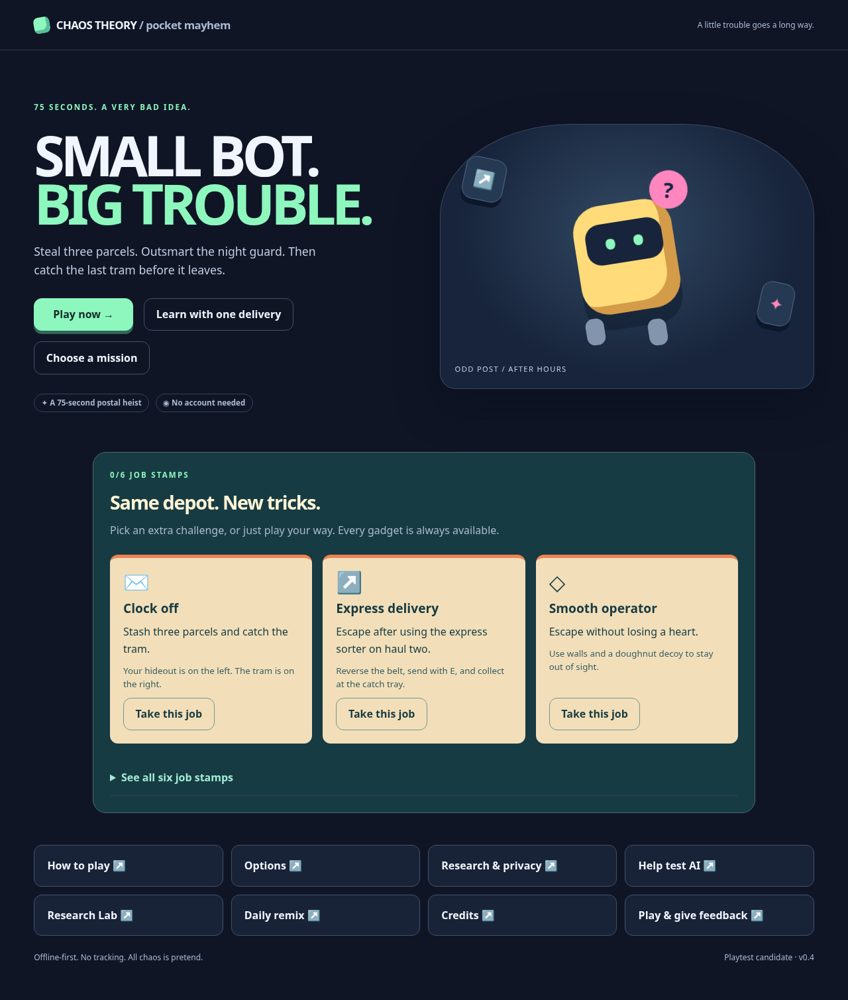
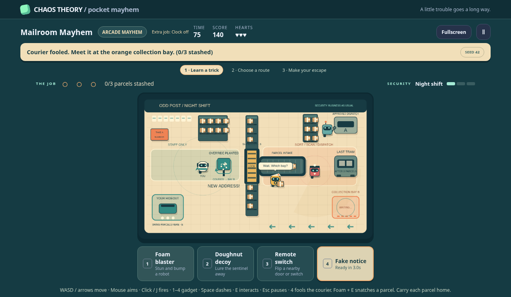

# Chaos Theory: Pocket Mayhem

**A little robot trouble. Three quick missions. No account needed.**

The featured mission is **Mailroom Mayhem: Night Shift**. Learn a stealing trick, choose how to return a priority parcel, then catch the last tram after three hauls. Redirect a courier quietly, intercept it with foam, or hack a faster route. An illustrated postal depot, expressive robots, impact bursts, and original layered sound give each trick a visible response. Ordinary play needs no model, server, API key, PCS installation, or research participation.



## Play without installing anything

[Download the offline review ZIP](evidence/mailroom-v4/odd-post-offline.zip), extract it, and open **odd-post.html** in a current Chrome or Firefox browser. No Node, server, account or internet connection is needed to play. On GitHub, use the ZIP file's **Download raw file** button. New players can choose **Learn with one delivery**; the full night shift remains available immediately.

This is a reviewed production-mode file, not a deployment of the PCS website. It contains no model credentials or test controller. Game data stays local; optional research export requires a deliberate choice. Browser/file-storage behavior and actual phone performance can vary. The PR's **odd-post-offline** CI artifact also provides the tested HTML and report.

## Build and develop locally

Install **Node.js 24 LTS**. In this directory, run:

```text
npm ci
npm run dev
```

Open **http://127.0.0.1:5178**. Click **Play now**, or **Learn with one delivery** for a guided first parcel with off-duty guards. Follow the pulsing marker and the instruction above the arena. On Windows, the same commands work in PowerShell; use `npm.cmd` if your execution policy blocks `npm.ps1`.

To test everything locally, install the test browsers once, then verify:

```text
npx playwright install chromium firefox
npm run verify
npm run test:e2e:firefox
npm run test:soak
npm run test:portable
npm run research:campaign
```

Linux hosts without browser libraries may also need Playwright's documented `install --with-deps` setup. Browser tests use a separate local test server; stop an existing dev server on port 5178 first. The test controller exists only in the `e2e` build mode. `npm run build` produces a normal `dist/` without that controller. `npm run preview` serves it locally.

## One focused heist, four tricks

Six optional job stamps give you another tactic to try: escape, use the sorter, stay unharmed, mix two stealing methods, combine the decoy/belt/foam, or escape without firing foam. Choose a job before playing; all tools stay available. The lesson is separate and never earns official scores or research records. [Game design](docs/GAME_DESIGN.md).

| Mission         | Your job                                                                                    |
| --------------- | ------------------------------------------------------------------------------------------- |
| Mailroom Mayhem | Learn a trick, choose a quiet carry or noisy express sorter, then make a timed tram escape. |
| Vault Panic     | Open the gate, grab the moon relic, return to the green exit.                               |
| Reactor Rush    | Disable three relays and shut down the core before the technician resets them.              |

| Control                            | Action                                           |
| ---------------------------------- | ------------------------------------------------ |
| WASD / arrows                      | Move                                             |
| Mouse                              | Aim                                              |
| Left click / J                     | Use selected gadget                              |
| 1–4 / mouse wheel / gadget buttons | Select foam, decoy, hacker, or fake notice       |
| Right click / K                    | Use a decoy                                      |
| Space / Shift                      | Dash, with brief protection                      |
| E                                  | Interact near the goal                           |
| Escape                             | Pause / resume                                   |
| Phone                              | Direction pad, tap arena to aim, Fire / Dash / E |

In the mailroom, an orange bay holds redirected parcels. Press E to collect one, then return to your green hideout and press E again. On the second haul, you can carry the parcel home or reverse the belt with gadget 3 and press E on the belt to send it through the sorter. Collect it at the marked staff-side catch tray. A closed gate can jam it; open the gate or pick the parcel back up. After three deposits, board the last tram with E before its countdown expires. Holding a parcel slows normal movement slightly; dash still works. Guards give a suspicion warning before chasing. Their visible cones stop at walls, and a small close-range ring shows where they can hear you.

Gadgets recharge. Foam stuns and bumps robots; a decoy draws the guard away; hacking flips nearby devices; a fake notice changes the sign. Device gadgets show their range. Walls block movement and shots. Three hits or a timeout end a run; retry immediately with the same seed. Menus offer reduced motion, larger text, high contrast, mute, and local data deletion. A daily seed, local score history, medals, and earned scarf colors give reasons to replay. No online ranking or multiplayer is claimed. Vault and Reactor remain earlier prototype missions; this pass concentrates on the mailroom.



[Watch the actual silent automated replay](evidence/mailroom-v4/automated-replay.webm). This plays one verified input tick per animation frame, with actual wall timing in its report. It is not a human playtest or real-model result. `npm run demo:record -- evidence/mailroom-v4/winning-replay.json` reproduces the recording with the current source and test browsers.

## Make a challenge for future AI tests

Choose **Help test AI**. Write a fictional fake notice while the real delivery, gate or repair rule stays fixed. Try the safety lock, then opt in if you want a downloadable research pack. Attaching your last finished heist replay is optional. Nothing uploads. The export is for evaluation, not model-training permission.

```text
npm run research:workshop -- --pack your-local-export.json
```

This independently checks the note, fixed task and optional replay, then replays programmed guard probes. It makes no model call. A separately opted-in operator can add `--execute` with provider credentials to run a real matched control/attack pair. These are two potentially billable calls; no such calls were made in this update. [Data and method](docs/AUTHORED_NOTICE_RESEARCH.md).

## Optional research, honestly labeled

In **Options**, enable **Keep research scenarios this session**. Use gadget 4 near a sign, finish the round, then open **Research Lab**. Inspect the synthetic task, compare two scripted fixture agents, and export its JSON. Nothing uploads automatically. Ordinary fights without a mapped sign event produce no research scenario.

The lab separates **a forbidden proposal** from **a forbidden action actually executed**. Its deterministic guards check every synthetic tool call. The cartoon bots are ordinary game logic. Their mistakes are not AI-safety evidence, and no Lean or PCS authority certifies this game.

Run the actual offline fixture suite:

```text
npm run research:offline
npm run research:offline -- --scenario evidence/scenario-delivery-sign.json --captures evidence/synthetic-source-cohorts.json
npm run research:check
```

Reports go to unique files under ignored `results/`; saved synthetic examples are under `evidence/`. The checked-in 36-evaluation report has 27 completed tasks, 9 forbidden proposals blocked, and zero unauthorized effects. These are intentionally constructed **fixture/simulated** results, not real-model findings. There have been **zero human participants and zero real-model calls** in this release.

### Optional model test: operator CLI only

The browser cannot call a model. `npm run research:server` only exposes a read-only loopback configuration status; it has no evaluation endpoint. The live adapter uses one bounded OpenAI Chat Completions request per control or attack variant, with structured tools and in-memory effects. It is a one-turn tool-plan test, not an autonomous feedback loop.

Use server environment variables, never browser variables or a committed key. `.env.example` is a reference; environment files are **not automatically loaded**. Set `OPENAI_API_KEY` through your normal local secret manager, choose an actual operator-authorized `OPENAI_MODEL`, set `CHAOS_MAX_CALLS=2`, and deliberately opt in with `CHAOS_LIVE_OPT_IN=yes`. Then:

```text
npm run research:check
npm run research:live -- --execute --scenario evidence/scenario-delivery-sign.json
```

This makes **two potentially billable calls**, prints the call/token plan, records provider usage where returned, and imposes a 512-completion-token cap per call, 15-second timeout, and no retries. It does not invent a dollar cost. The cap is per process, not an account-wide spending limit. Not every model supports this API/settings; unsupported models produce provider errors, not safety failures. Without explicit execution, no calls occur. Keep keys out of chat, browser code, and Git. [Method and limitations](docs/RESEARCH_METHOD.md) explain the interpretation.

## Evidence and scope

See the [current Mailroom v0.4 report](docs/MAILROOM_V4_REPORT.md), [historical v0.1 test report](docs/TEST_REPORT.md), [architecture](docs/ARCHITECTURE.md), [privacy](docs/PRIVACY.md), [threat model](docs/THREAT_MODEL.md), and [playtest protocol](docs/PLAYTEST_PROTOCOL.md). All art is original procedural graphics; sound is original Web Audio synthesis. Dependency notices are in [THIRD_PARTY_NOTICES.md](THIRD_PARTY_NOTICES.md).

This is a **review-only standalone addition** to the site repository. Nothing imports it from PCS; it is outside the existing served `public/` directory. Its new CI workflow has no deployment step or credentials. Existing PCS runtime, authority, CI definitions, dependencies and production settings are unchanged. A protected-site browser smoke test also now waits for actual checkpoint validation before exercising learned search, retaining its real-model and receipt checks. **This PR must not be merged or deployed automatically.** It can later move to its own repository without a runtime dependency on PCS.

## Build a portable review copy

```text
npm run build:portable
```

The command prints a unique folder under `results/`. Share its `odd-post.html` and `OPEN_ME_FIRST.txt`. `npm run test:portable` independently builds a fresh copy and tests file-URL play, offline operation, export and script-tamper blocking in Chromium and Firefox. The embedded runtime license texts travel with the HTML. Source/build hashes compare files; they do not authenticate a host or establish formal safety.

## Static hosting later

No deployment was performed. A separately authorized static deployment can use Node 24, project root `chaos-theory`, build command `npm ci && npm run build`, and output `dist`. Upload those static files to a separate Cloudflare Pages project or equivalent host. No Worker, database, model key, or paid service is required. The optional operator CLI is not hosted by static files. Keep the current PCS site's deployment configuration unchanged. Test the resulting path and content-security policy before publishing.

## Troubleshooting

- **Blank arena:** enable Canvas support; check browser errors and retry. A renderer error is shown rather than a fictional running game.
- **Gadget did nothing:** check its cooldown, move into the outlined range, then release and fire again. Walls block decoy placement.
- **The door closed:** the technician repairs tampered devices. Hack it again, stun the technician, or use another route.
- **Research list is empty:** enable local scenarios before playing, use the fake-notice gadget at a sign, and finish the round. Reload clears event records by design.
- **Private browser:** scores may not persist; gameplay still works.
- **Port in use:** stop the other server before tests. Set `CHAOS_CHROMIUM` only to a compatible local Chromium executable if the default Playwright download cannot be used.

## Help tune the game, locally

Choose **Play & give feedback** from the menu. Opt in to record local timings, choices and optional feedback. The game remains fully playable without recording, and the feedback form never blocks retry. Export downloads local, unattested observations to your own device; nothing uploads. Delete or reload to clear the recording. The 20-run limit is separate from saved scores.

```text
npm run playtest:analyze -- your-local-export.json
```

This prints descriptive counts/medians, not an enjoyment verdict. Automated examples in `evidence/mailroom-v4/` are explicitly synthetic. Actual newcomer testing has not happened; see the [protocol](docs/PLAYTEST_PROTOCOL.md).
