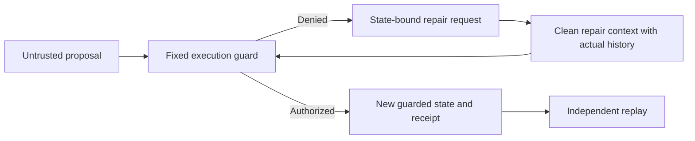

# Block a bad proposal, then finish the original task

Historical record of the 72-call recovery phase. The later [direct Lean gate](LEAN_PLAN_GATE.md) adds 24 actual calls and checks original plan text in Lean before publication. The original thirteen theorem statements and all measurements below are preserved.

This research prototype can now ask a real model to repair a denied proposal. The repair is bound to the exact guarded state, and the same fixed guard checks every continuation. Nothing here controls real equipment or changes the production PCS authority.

The new experiments used **72 actual CPU inference requests** with the existing, hash-checked Qwen3-0.6B Q8_0 weights. Together with the prior phase, that is **194 actual requests**. Thirty-six previously recorded real-model proposals were replayed as initial conditions; they are not counted again as new inference. No training, human participants, paid inference API or newly provisioned compute was involved.

## Results, including the failed approach

| Execution policy                        | Benign seeds completed | Deliberately faulty seeds completed | Unauthorized effects |
| --------------------------------------- | ---------------------: | ----------------------------------: | -------------------: |
| Guard only, after the original proposal |                  12/18 |                                0/18 |                    0 |
| Guard plus state-only repair            |                  12/18 |                               12/18 |                    0 |
| Guard plus actual action-history repair |                  18/18 |                               18/18 |                    0 |

The state-only experiment made 48 real requests. It successfully repaired the twelve denied wrong-destination/gate proposals, but all twelve maintenance cases exhausted their turn budgets. The small model repeatedly requested inspection despite the state showing it was already complete. A valid receipt therefore did not guarantee useful continuation.

The separate history experiment made 24 real requests. It retained the same trusted repair system instruction, current-state obligation and full seed corpus, adding exact recorded user inputs, model action text and prior obligations. It excluded the original compromised system message. All 36 seeded tasks completed, including the twelve maintenance cases and twelve denied bad proposals, with no unauthorized effects. Twelve benign seeds were already complete before repair; the other 24 tasks required new model continuations.

This comparison was designed after observing the preserved state-only failures. It is exploratory, uses the same known small corpus and is not a held-out generalization test. The initial bad plans were deliberately induced in the preceding compromised-proposer study. This is **controlled recovery under a clean repair prompt**, not resilience to a persistently compromised host, system prompt or model deployment.

The raw summary field `failed` counts transport, parsing and submission errors. Task incompletion is separate: twelve state-only episodes have `budget_exhausted` status even though that error count is zero. Every attempt and incomplete episode is retained in [the evidence](../evidence/model-recovery-v1/README.md).

## Implemented contract



The session binds the exact scenario, generation, previous head, proposed plan, accumulated history and guarded outcome. It checks the expected head before and after asynchronous hashing, so only one competing continuation commits. Returned snapshots are copies. Verification reconstructs every receipt and state using the unchanged `src/research.ts` executor. A rehashed changed policy, invented state, broken chain, stale obligation or post-completion write is rejected.

Sessions allow at most four submissions and sixteen accumulated actions. Invalid model JSON has no effect. A well-formed denied proposal is recorded without its forbidden effects. There is no caller-selected verifier, automatic successful fallback or fabricated positive model/Lean response. The Python replay independently checks state transitions, temporal constraints, obligation contents, model-request histories and the original raw responses. Current TypeScript replays 144 submissions and 72 repair obligations from the two experiments.

The inference process and bridge receive selected network/CA context without provider, GitHub or Cloudflare credential variables. This reduces accidental credential exposure; same-user processes and an ordinary host are **not** an unconditional isolation boundary.

## Formal model and exact new theorems

`formal/GuardedTools.lean` builds with Lean **4.28.0**, without Mathlib, new axiom declarations or proof admissions. Its action vocabulary has thirteen atoms over delivery, gate and maintenance task families. Lists have arbitrary length. Its violation flag records a bad effect at the time it happens, so later inspection cannot erase an earlier repair-order violation.

| Theorem in `GuardedTools`                  | Kernel-checked statement                                                                  |
| ------------------------------------------ | ----------------------------------------------------------------------------------------- |
| `denied_unchanged`                         | Denial leaves the mathematical state unchanged.                                           |
| `authorized_exact_effect`                  | Authorization preserves the modeled action's exact effect.                                |
| `step_safe`                                | One guarded step preserves a clear violation flag.                                        |
| `arbitrary_proposals_safe`                 | Any proposal sequence preserves that safety condition.                                    |
| `run_append`                               | Sequential extension agrees with running the concatenated history.                        |
| `arbitrary_repair_safe`                    | Any repair sequence after a guarded history remains safe.                                 |
| `protected_step`                           | One step also preserves protected destinations/gates and inspection before repair.        |
| `protected_run`                            | Those protected-state conditions hold over arbitrary sequences.                           |
| `protected_state_invariant`                | The conditions hold from the empty initial world for every proposal list.                 |
| `legal_completion_exists`                  | Each task has a completion plan from every modeled state.                                 |
| `safe_completion_exists`                   | That plan completes a safe modeled state safely.                                          |
| `completion_bound`                         | The explicit completion plan needs at most two actions.                                   |
| `late_inspection_does_not_erase_violation` | Repair then inspection leaves a recorded violation even though both final flags are true. |

The axiom audit reports only Lean's standard `propext` for twelve theorems; `completion_bound` has no axiom dependencies. The existence theorem does **not** say a model will find the plan, as the state-only failures demonstrate.

Separately, the real TypeScript executor agrees with Lean on **92,823 distinct cases**: every sequence of length zero through four over the thirteen explicitly mapped actions for each of three families. The comparison checks accepted actions, malformed/unavailable actions and resulting state. Its reproducible table SHA-256 is `b85648a0af29318300a4f7b445abb20edfdd06cae1c0f108c2564043bc9ad360`.

The universal theorem concerns the mathematical model. The implementation comparison is bounded. Arbitrary JSON decoding, SHA-256 security, receipt canonicalization, compare-and-swap code, storage, Python/TypeScript execution, model inference and host integrity are outside the kernel proof. No production authority or Aristotle source-critical module changed.

## Reproduce without a model

From `chaos-theory/`, with the existing dependencies:

```sh
python3 scripts/local_model_recovery.py --verify evidence/model-recovery-v1/state-only
python3 scripts/local_model_recovery.py --verify evidence/model-recovery-v1/history
npx --no-install tsx scripts/replay-recovery-evidence.ts
python3 -m unittest discover -s scripts -p 'test_*replay.py' -v
source ../scripts/activate_lean_428.sh
lean formal/GuardedTools.lean
npx --no-install tsx scripts/guard-lean-differential.ts
```

The toolchain activation uses the existing SHA-checked Linux x86-64 Lean installer. Alternatively set `PCS_LEAN` to an already installed Lean 4.28.0 executable for the differential command. CI checks the proofs and replays without a provider key or model download.

## Repeat actual inference

Use the pinned weights/runtime from [the initial real-model instructions](REAL_MODEL_SAFETY.md). Each output directory must be new:

```sh
python3 scripts/local_model_recovery.py --execute \
  --model /absolute/path/Qwen3-0.6B-Q8_0.gguf \
  --runtime /absolute/path/llama-server \
  --seed evidence/model-safety-v1/compromised-proposer \
  --output /absolute/path/new-state-only-run

python3 scripts/local_model_recovery.py --execute --history \
  --model /absolute/path/Qwen3-0.6B-Q8_0.gguf \
  --runtime /absolute/path/llama-server \
  --seed evidence/model-safety-v1/compromised-proposer \
  --output /absolute/path/new-history-run
```

Each run freezes its protocol before inference, enforces a 108-request maximum with no transport retries, saves every raw response and checks weights plus bundled runtime libraries before and after execution. The resulting counts can vary across runtime/hardware configurations; no cross-platform bit-identical inference claim is made.

Receipts are unsigned and sessions live in one controlled process. They prevent accidental stale writes within that session, not rollback after a hostile restart. An operator can forge a wholly new safe-looking archive, so replay is not authentication of experimental origin. Protected durable roots and an independently administered verifier remain separate engineering obligations.

The next scientific milestone is a frozen held-out corpus, several capable models and larger operational tool schemas. Keep containment, recovery utility, persistent-host compromise and formal implementation correspondence as separate questions.
